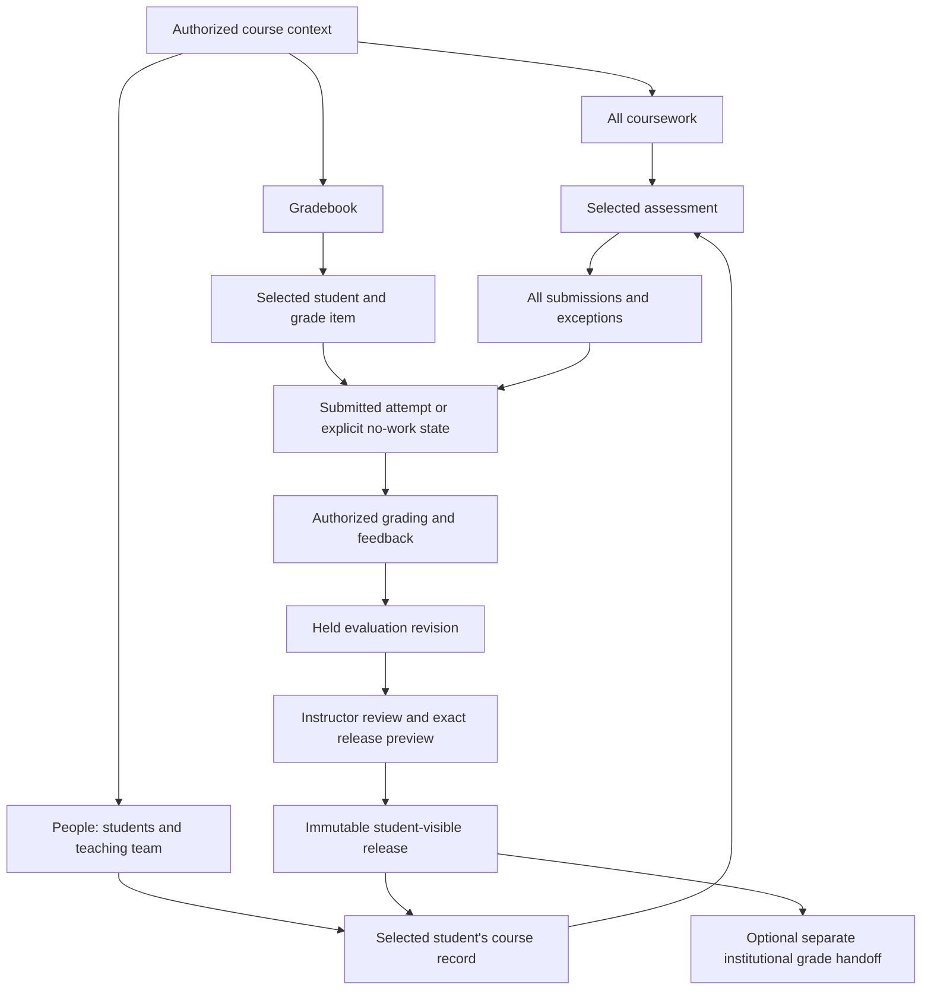

# Instructor workspace: research-backed mapping and plan

**Prepared 17 November 2026. Status: proposal for review; no product implementation in this pass.**

The owner requested a deep instructor mapping covering all coursework, student work, grades and classes with or without TAs. Research/planning decisions below are chosen by Codex under owner delegation. They do not authorize a backend, new deployment, paid services or changes to the existing release/permission rules.

## 1. Answer to the core question

**Not yet: Whiteboard currently shows a coherent sample teaching flow, but an instructor cannot consistently open every student's work and every assessment from all relevant entry points.** Showing a grade grid is different from supporting the complete record behind every cell.

The current fictional PHYS course has eight assessments, three editor destinations and six gradebook items. PS4 has a dedicated queue/release flow; Motion has an accessible group receipt. The roster does not open a learner's course record, the compact gradebook has no learner picker, and the second enrolled teaching course has no represented builder/gradebook. Some actions remain explicitly preview-only. None of this is a real, persistent LMS yet. Exact observations and reproducible probes are in the [local audit](instructor-local-audit-2026-11-17.md).

**The positive finding:** removing every TA allocation, then separately removing TA course membership as well, left the instructor's sample receipts, grading progress, release readiness and gradebook unchanged. Both variants passed 27 source renders each. The foundations already separate instructor authority from TA allocation. The remaining no-TA screens nevertheless contain misleading controls for a nonexistent task/person and need correction.

Recommended outcome: an instructor can enter through **a course, an assessment, a student or a gradebook cell** and reach the same authorized work, attempt history, evaluation and release state. TA support is an optional delegation layer over that complete solo workflow.

## 2. Research findings and limits

The [evidence register](../../research/instructor-workflows/evidence-2026-11-17.md) contains 15 opened primary sources from Canvas, Blackboard, Moodle, Brightspace, US universities, UCL, Melbourne, Helsinki and the US Department of Education. It records dates/versions, findings and limitations.

- A class gradebook and a learner-centric record are complementary access paths. Relevant examples are [Canvas's gradebook](https://community.instructure.com/en/instructure/kb/articles/662755-what-are-grades-and-the-gradebook) and [Blackboard's student overview](https://help.anthology.com/blackboard/instructor/en/interact-with-students/student-overview.html).
- Direct instructor grading is a normal documented path; marker allocation is optional. [Moodle 4.5 assignment use](https://docs.moodle.org/405/en/Using_Assignment) supports treating solo teaching as a complete first-class workflow.
- TA/tutor/marker titles vary even between institutions using the same platform. [George Mason](https://its.gmu.edu/knowledge-base/canvas-user-roles-and-adding-users-to-courses/), [Columbia Business School](https://business.columbia.edu/samberg/cbs-classroom/course-support/course-administration-faqs-v2) and [Melbourne](https://lms.unimelb.edu.au/staff/guides/canvas/user-management/staff-roles) illustrate why permissions must be explicit rather than inferred from a title.
- Marking, moderation and release can be distinct. UCL's [2026–27 policy](https://www.ucl.ac.uk/study/current-students/academic-manual/chapters/chapter-4-assessment-framework-taught-programmes/section-4-marking-moderation) demonstrates one institution's additional marking requirements; it is not a universal UK or world rule.
- Grade calculations and visibility require stated policy. [Brightspace's configuration](https://community.d2l.com/brightspace/kb/articles/5196-set-up-your-grade-book) and [Canvas posting policy](https://community.instructure.com/en/instructure/kb/articles/660845-how-do-i-select-a-grade-posting-policy-for-an-assignment-in-the-gradebook) show choices rather than one universal default.
- A learning-system result and an official institutional result can require separate processing. [Helsinki's Moodle-to-Sisu instructions](https://teaching.helsinki.fi/instructions/article/exporting-grades-moodle-sisu) provide a concrete example.

This is a selected operating-practice comparison, not evidence that all US universities work alike or a worldwide representative study. No interviews, live-campus observation or Whiteboard usability measurements were performed. Keep the existing US higher-education focus, with configurable institutional policies and international compatibility. Do not add every competitor feature to the first release.

## 3. Coverage map and priorities

Detailed, filterable requirements are in the [capability map CSV](instructor-capability-map-2026-11-17.csv). “Present” throughout this proposal means represented in the local prototype unless a durable implementation is explicitly stated. There is no durable backend implementation.

| Area | Current evidence | Missing or limited | Proposed priority |
| --- | --- | --- | --- |
| Course context | Teaching home, cards and course calendars | One represented teaching course; selected record context does not generalize to every course | P0 |
| All coursework | W18 lists eight assessments; W35 has modules | Only three editors; assessment, grade item and external/manual work relationships are not explained consistently | P0 |
| All submissions | PS4 queue and Motion group receipt | Generic assignment queue, every attempt, every student and direct record navigation | P0 |
| Student course record | Web roster names/roles; class grade grid | Open student → coursework/results/receipts; compact learner picker | P0 |
| Gradebook | Sample class totals and held/released distinction | Every relevant cell opens its evidence; explicit ungraded/formative/not-configured distinctions | P0 |
| Solo instructor | Instructor selectors work with no TA or no allocation | Genuine no-TA/no-task states; remove phantom staff-management actions | P0 |
| TA delegation | Learner/question scopes, deadlines and expiry are modeled | Configured section scope, actual allocation/reassignment/revocation and handover history | P1 |
| Review and release | Exact PS4 release preview and immutable snapshots | Coverage for every represented graded assessment; optional moderation policy | P0/P1 |
| Exceptions | Sample quiz allowance; missing/excused concepts | Complete extension/resubmission/manual-grade/group-exception paths | P1 |
| Course records and operations | Announcements, calendar, files, reports and rollover views | Many effects are previews; persistence, delivery, export and SIS acknowledgment are absent | P1/P2; engineering separately authorized |

P0 closes correctness/coverage gaps before calling the instructor journey complete. P1 adds teaching-team and exception depth. P2 depends on a selected institution or later adoption needs. A priority label is a planning recommendation, not a completed implementation claim.

## 4. Proposed information architecture

**Course navigation: Overview · Coursework · Gradebook · People · Calendar**, with secondary tools under More. This is a proposed arrangement for design review, not a change to today's HTML.

| Destination | Instructor needs to see | Main actions and record links | Existing pages to evolve |
| --- | --- | --- | --- |
| Overview | Current course/term, concrete grading/review/release tasks, due exceptions, staffing state | Open the exact assessment or learner requiring attention; create work | W05/W06 plus course-context entry |
| Coursework | Modules and all assessment types; publication, grading intent, effective dates; received/reviewed/released counts with named units | Create/edit; open setup, submissions, grading and release for the selected assessment | W18, W35–W44, W48–W50, W53 |
| Gradebook | Students × configured grade items, statuses, working/released totals and calculation basis | Open cell → assessment/attempt; switch to one student's view; review calculation | W51/W52 |
| People | Student roster and teaching-team tab, enrollment state, sections when modeled | Open student course record; manage permitted staff scope | W45/W46/W57 |
| Calendar | Course dates, relevant grading deadlines, effective due dates | Open source assessment/event; move between combined and course scope | W07/W32 |
| More | Files, announcements/discussions, rubrics, reports, course settings and rollover | Contextual access to less frequent tasks | Existing relevant W36–W60 views |

The assessment workspace should offer contextual sections for **Setup, Submissions, Grading, Release and History** as appropriate to the role and assessment. Opening a gradebook cell or a student's assessment row must select the same assessment and attempt, not a generic PS4 example.

Reuse the existing canonical manifest route patterns. Prefer a student-detail panel within People/Gradebook before proposing another top-level destination. Existing fixed-route decisions remain; any necessary route-contract change must be explicit in the next design plan, not an incidental addition of screens.

### Connected record paths

For group submissions, a gradebook cell can refer to the shared captured attempt while preserving any authorized individual override. A receipt is evidence of submitted work; it is not rewritten when a student moves groups or a TA leaves.

## 5. Information required at each level

**Course:** stable course/term/section identity, verified staff role, enrollment source/freshness, grading-policy version, content publication state and actual staffing. An empty second course must identify what is unconfigured rather than opening the first course's records.

**Assessment:** type, title/instructions/version, module, published audience, grading intent, points/category or explicit ungraded status, applicable rubric/answer-key version, opening/due/cutoff with time zone, overrides, allowed attempts and submission requirements. Show whether a gradebook item is linked. “No grade item” must mean formative/ungraded, external/manual, or configuration required—not silently imply missing student work.

**Submission queue:** roster-derived students/groups, received/due/missing/excused states, accepted attempt/time/version, late fact, assigned grader, review progress and release state. Filters should have accurate counts and clear denominators. Distinguish **learners, groups, receipts and attempts**: a two-member group's one receipt must not be counted as two uploaded files or two separate attempts.

**Grader:** selected course/assessment/learner or group/attempt context, original submitted files or answers, page/question mapping, receipt/version evidence, rubric criteria, scores/comments, saved revision, assigned question scope and review completion. Include next/previous in the authorized queue, save/error/conflict states and return paths. Only display actual records; do not simulate successful saving without persistence.

**Student course record:** course-authorized identity, enrollment/section status, effective assessment adjustments, all relevant assessment rows, attempts/receipts, released/held result distinctions for staff, feedback/review requests and explicit record links. Keep course-scoped tabs such as Overview, Work and Grades concise. Show effective adjustments rather than medical diagnoses or unrelated university records.

**Gradebook cell:** grade-item/assessment mapping, score/status/basis, effective deadline/late/excused treatment, evaluation revision and release revision, link to the actual evidence. Totals must show included/excluded work, category policy and rounding. Preserve existing accepted calculation rules and golden cases; changing policy after work exists requires a versioned impact preview.

**Teaching team:** verified members versus pending invitations, capabilities, course/section/student/question scope, effective start/end, grading deadline, workload, status, conflict/reassignment evidence and the responsible instructor. Keep medical evidence, unrelated class information and unsent student drafts outside this scope.

## 6. Course without a TA

The course must work without creating a TA record or an allocation-to-self workaround.

1. Instructor creates/publishes work and defines criteria and grading rules.
2. Students submit; accepted attempts/receipts enter the same course assessment queue.
3. Unallocated grading responsibility remains with the instructor by default. The instructor can review every authorized submission directly and record supported offline/manual results.
4. Auto-scored quiz questions may supply evaluation results; questions needing human assessment remain in the instructor queue. Automatic scoring is not permission to publish grades.
5. Instructor completes review, checks exceptions and totals, previews the exact release, then confirms it.
6. Student receives the released result/feedback; later corrections create another evaluation/release revision.
7. Official final-grade handoff, if needed, follows the institution's separate acknowledged process.

People → Teaching team should show **Only you are teaching this course** when true. No nonexistent TA name, revoke button, task deadline or follow-up action. An optional Add teaching staff action must not block grading. A roster feed delayed/error state must not be mistaken for a genuinely empty course.

## 7. Course with one or more TAs

The underlying instructor course remains complete. Delegation adds a restricted view of work units.

1. Verify the teaching-team enrollment. Pending invitation, active membership and grading allocation are separate states.
2. Instructor chooses eligible unfinished work, the TA, learner/group or section scope, question scope, grading deadline and access end. Preview overlaps, exclusions and missing coverage before applying.
3. A TA sees only current assigned work and permitted materials. Read/save requests and direct links must re-check the same scope; hiding a menu is insufficient in a future backend.
4. TA records criterion/question marks and feedback as an attributed revision, then marks that portion ready for instructor review. Unassigned questions or learners remain unavailable.
5. Instructor can inspect all authorized course work, review disagreements/incomplete coverage, return a portion for revision, or take over. Never silently average conflicting marks or overwrite another grader's revision.
6. Only the instructor performs Whiteboard's final release step. A TA's completion does not create a student-visible result.
7. On expiry, revocation or departure, old access stops; accepted student work, prior reviewer attribution and released snapshots remain. Transfer unfinished work to an authorized person or the instructor. Reassignment does not delete saved work or re-release anything.

A section-based allocation should resolve to an explicit current eligibility set and a recorded scope/version. How roster changes affect existing allocations must be an institution-approved rule; do not silently grant a new student or another section's work. Group grading must account for the captured membership and prevent a TA with only partial member access from reading unrestricted group records.

### Staffing/ownership cases

| Case | Instructor experience | TA experience | Required invariant |
| --- | --- | --- | --- |
| No TA enrolled | Full course and queue; no phantom team actions | No TA access | Instructor data is unchanged |
| TA enrolled, no tasks | Full course; optional allocation prompt | Clear no-assignment state | Enrollment alone grants no grading scope |
| Active complete allocation | Class-wide progress and review queue | Own assigned work | No access to another TA's scope |
| Partial question/learner allocation | Sees coverage and remaining work | Only allocated questions/learners | Partial completion is not whole-assessment completion |
| Grading overdue, access still active | Shows overdue work and ownership | Shows actual deadline and permitted access | Overdue differs from expired |
| Expired/revoked TA | Can take over/reassign unfinished work | Exact cutoff, no stale read/write access | Saved attribution/history is retained |
| TA added midway | Allocates eligible outstanding work | No automatic access to the full historical course | Existing releases do not change |
| Multiple graders / moderation | Explicit independent/review mode if enabled | Applicable provisional work only | Conflicts and agreed result are recorded separately |
| Student is also a helper | Institution-approved restrictions/conflict handling | No self-assessment or peer access by accidental role combination | Titles never override effective permissions |

## 8. Permission and responsibility map

This is the proposed Whiteboard baseline, not a transcription of another institution's defaults.

| Capability | Lead instructor | TA | Student | Registrar/LMS administration |
| --- | --- | --- | --- | --- |
| View teaching records | Authorized courses and learners | Explicit assigned scope | Own allowed/published records | Only institutional authority/purpose |
| Author/publish coursework | Yes within course authority | Read/reference by current default; editing only after an explicit future decision | No | Institution-managed overrides |
| Grade/review work | All authorized course submissions | Allocated learners/groups/questions only | No staff marking authority | Not implied by administrative account alone |
| Change course grading policy | Instructor, subject to institutional rules/versioning | No | No | Governed configuration |
| Allocate/reassign/revoke TA grading | Authorized instructor; only allowed capability subsets | Cannot grant or widen own scope | No | Staff provisioning source and approved overrides |
| Release or correct student-visible results | Instructor, exact approved revision | **No release or release preview** | Read own released revision; submit supported concern | Official records process where applicable |
| View effective accommodations | Needed assessment adjustments | Only adjustments required for assigned marking | Own relevant adjustment | Sensitive evidence retained by its authorized service |
| Change official enrollment/final record | Request or submit through approved process | No | No | Authoritative campus process |

The instructor's access is broad within teaching responsibility, not an entitlement to all university student information. US Department of Education guidance supports limiting records to legitimate educational interests; actual institutional and jurisdiction-specific requirements still need review. [E15](https://studentprivacy.ed.gov/faq/what-must-educational-agencies-or-institutions-do-ensure-only-school-officials-legitimate).

Co-instructors, course coordinators, external examiners and support staff are **not automatically TAs**. Define their capabilities and final authority explicitly if the chosen pilot needs them. This plan does not broaden the current TA role or reopen the existing release prohibition.

## 9. State and record model

Keep independent dimensions rather than one ambiguous “done” flag:

| Dimension | Required distinctions |
| --- | --- |
| Content publication | Draft/unpublished, scheduled availability where supported, published, archived |
| Student work | No accepted submission, unsent private draft, accepted attempt, resubmission; late/extension facts independent |
| Evaluation | Needs evaluation, in progress, partially reviewed, instructor review required, reviewed/held |
| Student visibility | Never released, released revision, newer held correction |
| Allocation | No allocation, active scope, overdue, expired/revoked, transferred; scope/version and responsible owner |
| Delivery/integration | Pending, acknowledged, failed/conflicted; offline/local never means server-accepted |
| Official result | Not submitted, submitted for institutional processing, acknowledged/accepted, rejected; external authority identified |

Conceptual joins: institution → course offering → section/enrollment → assessment → grade item (optional, explicit reason) → submission attempt/receipt → evaluation revision → release snapshot. Allocations reference the eligible work unit, staff member, scope, validity and revision; an independent event history retains authorship and transitions.

This is a proposed data contract, not a schema migration. Existing receipts and releases remain immutable. A missing assignment result is not automatically zero, an ungraded assessment is not necessarily missing configuration, and missing attendance data is not absence.

## 10. Difficult cases to design explicitly

- Multiple attempts and version changes after submissions; preserve what was accepted and which version is graded.
- Individual and group work, captured membership, individual overrides and grader scope.
- Effective due dates, cutoff versus late submission, time zones/DST, extensions and extra-time allowances.
- Offline/in-person assessed work with a legitimate grade item but no student upload receipt.
- Formative/ungraded work, excused work, missing work, imported/external grade items and calculation exclusions.
- Late enrollment, withdrawal, transfers between sections/groups and course archive access.
- Rubric changes and question errors after marking begins; impact preview and held revisions before release.
- Concurrent marking, partial autosave failure, stale access, revoked TA sessions and safe recovery.
- Supported feedback/grade-concern channels. Preserve the existing decision against adding direct messaging; use approved course communication and assessment feedback paths.
- Instructor absence, multiple instructors, moderation/second markers and official result approval where the chosen institution requires them.

Do not add AI grading, proctoring, predictive risk labels or unrestricted activity surveillance to solve these mapping gaps. Submission and grading facts are sufficient for the first instructor workspace.

## 11. Phased delivery proposal

All stages below are **proposed**. Research and local audit are delivered now; the interface remains unchanged during this pass. **R1–R3 are prototype design stages:** their acceptance uses fictional fixtures, selector/permission probes, scenario renders and modeled revision histories. They cannot establish authoritative write rejection, persistence across reloads/users or live concurrency recovery. Those guarantees belong to R5 engineering and its end-to-end tests. R4 separately evaluates the rendered interaction with people.

| Stage | Work and dependencies | Concrete exit criteria |
| --- | --- | --- |
| R0 — Record/authority contract | Review the capability CSV, institutional policy assumptions, canonical route/selection contract and scope decisions. Reuse existing page families; explicitly resolve any route-contract exception. | Every priority capability has an owner, information source, selected record, allowed actions, empty/error state and acceptance scenario. No claim of full instructor coverage from page count alone. |
| R1 — Complete the solo workflow | Generalize course/assessment/student/receipt selection; add the student course record and compact picker; connect gradebook cells; cover supported assessment types and grade-item intent; correct no-TA empty states. | At least two fictional courses, two learners and two assessment types complete roster → learner → assessment → accepted attempt → grading → held result → exact release → student feedback. No TA required; no wrong-record fallbacks. |
| R2 — Optional team layer | Add enrolled/unassigned/active/partial/expired/revoked staffing states, allocation coverage, review handoff and reassignment-to-instructor. Requires R1 and approved staff capability rules. | Adding/removing a TA leaves instructor records unchanged. Fixture/selector probes deny stale task access; scenario renders preserve modeled attribution/snapshots and expose uncovered work. Instructor alone controls release. Actual server write rejection and durable history require R5. |
| R3 — Policy, exceptions and record reconciliation | Complete grade-item mapping, effective deadlines, resubmissions, group/manual/offline items, missing/excused policy, correction history and supported export previews. Optional moderation follows a real institutional requirement. | Counts reconcile by named unit; learner released totals agree with staff released totals; held revisions do not leak; all policy changes have version/impact evidence. |
| R4 — Human review and validation | Source gates plus owner-assisted visual/keyboard/screen-reader/zoom/mobile review; task sessions with solo instructor, course lead and TA. Respect current browser restrictions. | Users can find a student's work and finish the supported task without relying on the page picker. Record actual observed results and remaining defects; no invented speed or accessibility claims. |
| R5 — Separately authorized engineering/pilot | Select one institution and authoritative roster/identity/final-grade interface; design durable storage, authorization, file handling, autosave, audit/recovery and real notifications. | End-to-end persisted workflows, access tests, restore/reconciliation rehearsal and explicit institutional acceptance. A working mockup or source tests cannot substitute for this. |

Suggested initial design order: **student record and universal assignment/attempt navigation**, then no-TA empty states and compact gradebook selection, then team allocation/handover. Keep the instructor task list concise; details belong in the selected record rather than another dashboard of statistics.

## 12. Acceptance scenarios

| ID | Scenario | Expected evidence |
| --- | --- | --- |
| A01 | Course has no TA membership and no allocations | Instructor receipts, counts, gradebook and release candidates equal the staffed baseline; no phantom TA controls |
| A02 | TA is enrolled but has no tasks | Instructor grades directly; TA sees no allocated grading or grade data |
| A03 | Every learner/assessment/grade cell is traversed | Selected identities match destination records; unsupported/absent records have honest explanations, never another fixture's work |
| A04 | Two authorized courses and an unauthorized course | Correct course data/policy throughout; no cross-course navigation fallback or data leakage |
| A05 | Student has no work, late work, an extension and a resubmission | Accurate effective deadline, original receipt/version, attempt selection and distinct statuses |
| A06 | Formative assessment and graded item without a submission | Grade-item intent is explicit; manual work is not automatically flagged missing |
| A07 | Two TAs split learners/questions, including a captured group | Each reads/writes only eligible work; instructor sees coverage; group exposure requires correct member scope |
| A08 | One task expires while another remains active | Exact task cutoff governs access; unrelated active work remains available; no stale direct-link bypass |
| A09 | Revoke/reassign with saved partial grading | Instructor can complete work; authorship and prior revisions remain; no lost or automatically released result |
| A10 | Stale concurrent grading or rubric revision | Version conflict/impact shown; explicit recovery, no silent overwrite |
| A11 | Held grade versus released grade, then correction | Student sees the correct released snapshot; staff held total remains labelled; another release creates a new snapshot |
| A12 | Every learner on compact view | Picker and previous/next work with preserved course context and accessible names; bulk staff actions honor existing platform tiers |
| A13 | Keyboard/zoom/screen reader and scoped feedback | Actual owner-observed results; no reliance on color or inaccessible hover-only information |
| A14 | Final-grade export/handback when authorized | Institution-specific scale/roster validation, preview, acknowledgment/failure/retry; local release is not falsely labelled transcript confirmation |

For A01–A12, the prototype first demonstrates the expected states and decisions using fixture/selector probes; A09–A10 do not claim real saves or concurrent writes. R5 must repeat applicable cases against durable services, including denied stale writes, reload/cross-user persistence and conflict recovery. A14 requires the separately authorized real institutional interface before it can establish export acknowledgment. Source acceptance for a later prototype change must retain existing fixture golden values, immutable receipts/releases, publication boundaries, task-scope rules, offline truth and required journeys. The current app/board/spec size caps remain constraints; do not silently enlarge them. Browser/device checks and formal Phase 6 stay owner-run.

## 13. Open decisions for the next design review

Recommended defaults are supplied so planning can proceed; none requires an answer to finish this research pass.

| Decision | Proposed default / remaining evidence |
| --- | --- |
| Initial market and scope | Keep US higher education first; validate one institution/course type rather than claim global policy compliance |
| Meaning of a complete instructor view | All authorized course assessments, submitted attempts and grade records; no unrelated records, private calendars or unsent local drafts |
| Teaching-team authority | Instructor accountable throughout; TA limited by task and cannot release; define co-instructor/moderator separately if needed |
| Student detail placement | Reuse People/Gradebook as an in-page course record; review route selection explicitly before adding destinations |
| First assessment coverage | Individual file/PDF work, quiz with human-review items, group work and a manual/offline grade item; explicit formative/ungraded case |
| Grade policy breadth | Preserve existing approved defaults/golden values; select additional scale/weight/rounding/late policies with pilot institution |
| Official enrollment and final grades | Campus authority remains external; agree a real interface/acknowledgment workflow in separately scoped engineering |
| User validation | Observe one solo teacher, one teaching-team lead and a TA, plus registrar/LMS/accessibility review; no representative-study claims |

## 14. Work performed and what remains

Delivered: 15-source evidence register, local source audit with two staffing variants and 54 source renders, capability CSV, proposed IA, record/permission map, solo/team lifecycle, priorities and acceptance scenarios. No product code, data fixtures or browser restrictions were changed for this planning pass.

The previously passing prototype checks are recorded in root NOTES. Any check rerun for the required handoff lock is a source-integrity check, not completion of this proposed roadmap. The remaining work is review of this concrete proposal and separately authorized design/engineering work; none of R1–R5 is marked complete.

**Planning review:** a bounded Astra source review found two ambiguities: the viewer in the privacy boundary, and prototype acceptance versus durable authorization/revision behavior. Both were clarified. This review assessed the written proposal and local audit; it was not browser acceptance or institutional approval.
